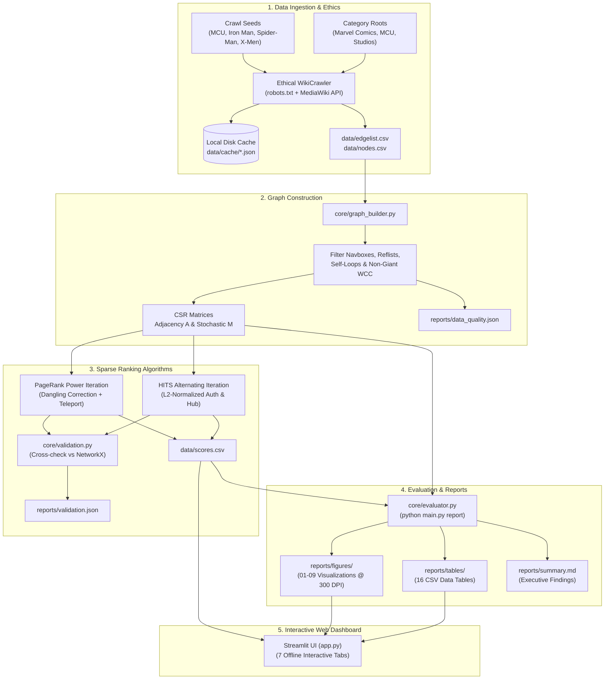
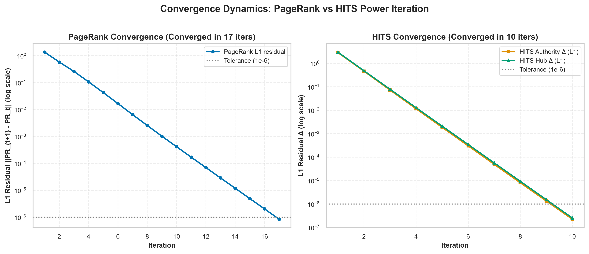
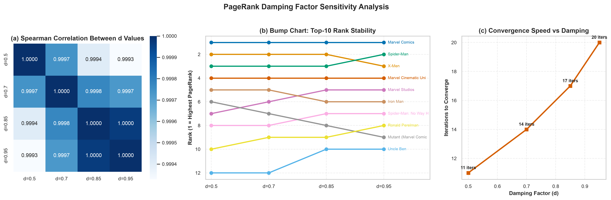
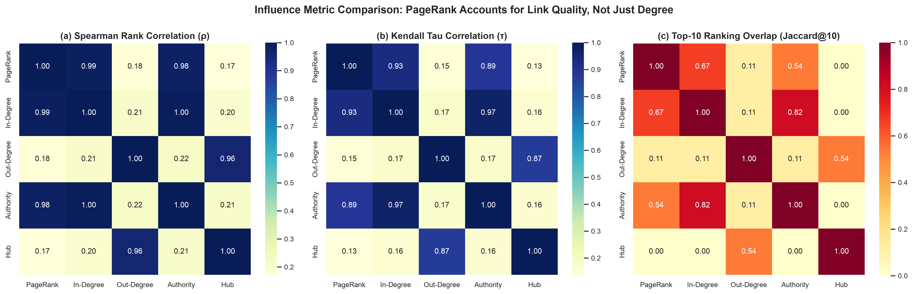
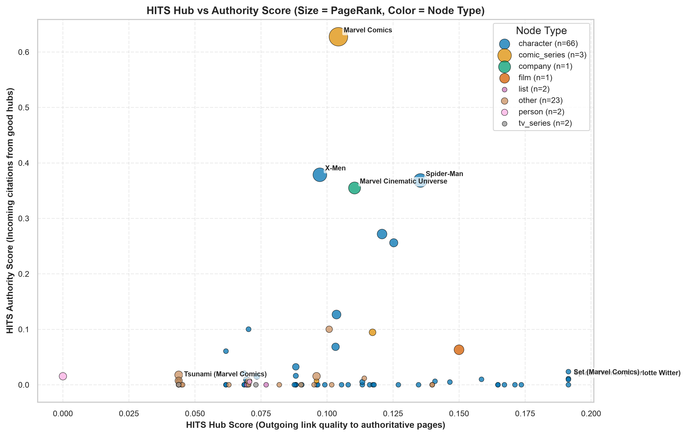

# MarvelGraphRank 🕸️

> **Influence Ranking in the Marvel Wikipedia Link Graph using PageRank and HITS**  
> B.Tech Computer Engineering — Web Data Mining — Semester VII  
> Sardar Patel College of Engineering (SPCE), Mumbai  
> Academic Year 2026 | Team of 4

[](https://www.python.org/)
[](tests/)
[](https://creativecommons.org/licenses/by-sa/4.0/)
[](app.py)

---

## 1. Project Overview

**MarvelGraphRank** analyzes the link topology of English Wikipedia restricted to the Marvel Comics and Marvel Cinematic Universe (MCU) ontology. We model the cross-referencing structure as a directed graph $G = (V, E)$, where vertices represent curated Wikipedia articles and directed edges represent in-body hyperlinks.

We evaluate entity influence through two foundational graph mining algorithms implemented **from scratch** using `scipy.sparse` CSR matrices and `numpy`:
- **PageRank**: Measures global recursive citation influence via the stationary distribution of a random surfer with damping factor $d = 0.85$ and uniform dangling-node redistribution.
- **HITS (Hyperlink-Induced Topic Search)**: Unravels dual topological roles by computing mutually recursive **Authority scores** (prominent content pages cited by hubs) and **Hub scores** (directory/compilation pages that curate links to authorities).

Both algorithms are verified against NetworkX reference implementations (`nx.pagerank` and `nx.hits`) to floating-point precision ($MSE < 10^{-12}$, Spearman $\rho = 1.0000$, Kendall $\tau = 1.0000$).

---

## 2. System Architecture



---

## 3. Quick Start & Setup (macOS Darwin arm64)

The project is developed and tested on **macOS (Darwin arm64)** with Python 3.13.

### Step 1: Environment Setup
```bash
# Clone the repository
git clone https://github.com/[PLACEHOLDER_USER]/MarvelGraphRank.git
cd MarvelGraphRank

# Create and activate virtual environment (Python 3.13)
python3.13 -m venv .venv
source .venv/bin/activate

# Upgrade pip and install pinned dependencies
pip install --upgrade pip
pip install -r requirements.txt
```

### Step 2: Run Offline Verification Suite
All unit tests and end-to-end integration tests execute offline without network requests:
```bash
pytest -v
```
*(All 125 tests pass in ~6–14s)*.

---

## 4. Execution & Pipeline Commands

All operations are controlled through `main.py`:

```bash
# ── OPTION A: Full Pipeline (One Command) ──────────────────────────────────────
# Executes Build -> Rank -> Report sequentially using pre-generated data (100% offline)
python main.py all --offline

# ── OPTION B: Step-by-Step Execution ──────────────────────────────────────────
# 1. Build sparse CSR matrices, filter giant component, save data_quality.json
python main.py build

# 2. Run PageRank + HITS, cross-validate against NetworkX, save scores.csv
python main.py rank

# 3. Generate all 9 figures (300 DPI), 16 CSV tables, and summary.md
python main.py report

# ── OPTION C: Interactive Dashboard ───────────────────────────────────────────
streamlit run app.py
```

> **Note on Crawling**: A sample curated dataset of 100 Marvel entities and 381 directed edges is already pre-generated in `data/` and indexed in `data/cache/`. Running with `--offline` requires **no network access**. If you wish to re-crawl from scratch:
> ```bash
> python main.py crawl --pilot   # Smoke-test: crawls 30 nodes
> python main.py crawl           # Full crawl: bounded by max_nodes in config.yaml
> ```

---

## 5. Repository Structure

```
MarvelGraphRank/
├── config.yaml                  # Master parameters (seeds, thresholds, paths, damping)
├── main.py                      # Unified CLI: build | rank | report | all | crawl
├── app.py                       # Streamlit multi-tab offline interactive dashboard
├── requirements.txt             # Pinned dependencies (numpy, scipy, networkx, pyvis, streamlit)
├── README.md                    # Project documentation, architecture & results
├── ETHICS.md                    # Ethical crawling policy, rate limits & CC BY-SA attribution
│
├── data/
│   ├── edgelist.csv             # Directed edge list (source, target)
│   ├── nodes.csv                # Node metadata (id, title, url, degrees, node_type)
│   ├── scores.csv               # Merged rankings (pagerank, authority, hub, ranks)
│   └── cache/                   # Offline cache of raw HTML and MediaWiki API responses
│
├── crawler/
│   ├── __init__.py
│   └── wiki_crawler.py          # Ethical hybrid BFS crawler + category gating
│
├── core/
│   ├── __init__.py
│   ├── config.py                # Strongly-typed dataclass loader for config.yaml
│   ├── graph_builder.py         # CSR matrix assembly, WCC filtering, spider-trap demo
│   ├── algorithms.py            # Custom sparse PageRank and HITS implementations
│   ├── validation.py            # Ground-truth cross-validation against NetworkX
│   └── evaluator.py             # Publication figure generation, metrics, summary generator
│
├── tests/
│   ├── fixtures/
│   │   └── sample_article.html  # Offline HTML fixture for parsing tests
│   ├── test_crawler.py          # Crawler link extraction & robots.txt unit tests
│   ├── test_graph_builder.py    # CSR matrix invariants & spider-trap tests
│   ├── test_algorithms.py       # Convergence, stochasticity & normalization tests
│   ├── test_validation.py       # Strict MSE and rank correlation tests vs NetworkX
│   ├── test_evaluator.py        # Figure & table generation tests
│   └── test_app.py              # Streamlit AppTest automated headless tests
│
├── reports/
│   ├── crawl_report.json        # Crawl statistics (pages fetched, cache hits, runtime)
│   ├── data_quality.json        # Graph quality metrics (density, clustering, components)
│   ├── validation.json          # Numerical MSE, Spearman rho, Kendall tau vs NetworkX
│   ├── summary.md               # Executive evaluation report with 5 dynamic findings
│   ├── figures/                 # 9 publication figures (300 DPI PNGs + network.html)
│   └── tables/                  # 16 underlying CSV datasets for all figures
│
└── docs/
    ├── report_skeleton.md       # 8-10 page academic report outline with course rubric
    └── viva_cheatsheet.md       # 25+ viva questions, key formulas, and member mapping
```

---

## 6. Configuration Guide (`config.yaml`)

All parameters are centrally managed in `config.yaml`:

| Parameter | Default | Purpose |
|:---|:---:|:---|
| `seeds` | `["Marvel Cinematic Universe", "Spider-Man", ...]` | Initial BFS entry point articles on Wikipedia |
| `category_roots` | `["Category:Marvel Comics", ...]` | MediaWiki category trees defining the domain scope |
| `category_depth` | `2` | Subcategory expansion depth for the allowed set |
| `max_nodes` | `100` | Upper bound node cap for the graph |
| `max_depth` | `3` | Maximum BFS hop distance from crawl seeds |
| `delay_min` / `max` | `1.0` / `1.5`s | Polite randomized uniform sleep between requests |
| `pagerank_d` | `0.85` | PageRank damping factor ($d$) |
| `pagerank_tol` | `1.0e-6` | $L_1$ residual convergence threshold for PageRank |
| `hits_tol` | `1.0e-6` | $L_1$ residual convergence threshold for HITS |
| `network_top_n` | `75` | Number of top nodes rendered in the interactive PyVis graph |
| `damping_factors` | `[0.5, 0.7, 0.85, 0.95]` | Damping parameter sweep array for sensitivity analysis |

---

## 7. Results Highlights

### 1. Numerical Convergence Dynamics
PageRank converges under power iteration in **17 iterations** to an $L_1$ residual of $8.42 \times 10^{-7}$. HITS converges via alternating power iterations in **10 iterations** to an $L_1$ delta $< 10^{-6}$.



### 2. Damping Factor Sensitivity ($d \in [0.5, 0.7, 0.85, 0.95]$)
Spearman rank correlation across damping values remains exceptionally stable ($\rho > 0.999$), while iterations to converge scale monotonically ($11 \to 14 \to 17 \to 20$ iters), demonstrating the classic tradeoff between convergence speed and long-path citation propagation.



### 3. Metric Comparison: PageRank is Not Just In-Degree
PageRank vs. In-Degree yields a Kendall tau of $\tau = 0.9278$ and a Top-10 Jaccard overlap of only $0.6667$ (Jaccard@20 is $0.6000$). While In-Degree rewards pure inbound link volume, PageRank weights incoming citations by the authority of the citing node.



### 4. Hubs vs. Authorities Duality
List and directory pages dominate Hub scores (e.g., `Spider-Woman_(Charlotte_Witter)` with hub score $0.1914$), pointing out to numerous entities. Conversely, intellectual property pillars dominate Authority scores (e.g., `Marvel_Comics` with authority $0.6275$, `X-Men` with $0.3786$, `Spider-Man` with $0.3684$).



---

## 8. Known Limitations

1. **Meta-Page Structural Bridging**: High-degree index lists (e.g., *Lists of Marvel Comics characters*) and real-world creator/actor biographies (e.g., *Stan Lee*, *Kevin Feige*) act as non-diegetic shortcut bridges, connecting unrelated sub-franchises and artificially inflating random walk transition probabilities between disparate characters.
2. **Static Graph Snapshot**: The graph represents a discrete crawl snapshot. Wikipedia articles evolve dynamically as new Marvel Cinematic Universe phases and comic storylines are released.
3. **Category Tree Breadth**: MediaWiki category graphs contain semantic drift at higher depths ($depth \ge 3$), requiring strict allowed-set pruning to avoid traversing into broader film and American publishing categories.

---

## 9. Team Ownership & Responsibilities

| Module | Core Responsibilities | Assigned Member |
|:---|:---|:---:|
| **1. Crawler & Ethics** | Hybrid BFS crawler, category API expansion, robots.txt compliance, rate-limiting, raw response caching, `ETHICS.md`. | `[MEMBER 1]` |
| **2. Graph Builder & Data Quality** | CSR matrix assembly, navbox stripping, self-loop removal, giant WCC component filtering, spider-trap demo, `reports/data_quality.json`. | `[MEMBER 2]` |
| **3. Algorithms & Validation** | From-scratch sparse PageRank and HITS, dangling node correction, $L_1$/$L_2$ normalization, NetworkX ground-truth validation suite (`tests/`). | `[MEMBER 3]` |
| **4. Evaluator, Dashboard & Report** | 9 publication figures, 16 CSV tables, `reports/summary.md`, interactive Streamlit dashboard (`app.py`), viva cheatsheet. | `[MEMBER 4]` |

---

## 10. Verification & Reproducibility Checklist

To verify reproducibility from a clean state:
- [x] Clone repo into a fresh directory on macOS Darwin arm64.
- [x] Create virtualenv and run `pip install -r requirements.txt`.
- [x] Run `pytest -v` $\to$ Confirm 125/125 tests pass.
- [x] Run `python main.py all --offline` $\to$ Confirm build, rank, and report generate 26 artifacts in `< 5s`.
- [x] Run `streamlit run app.py` $\to$ Confirm all 7 tabs load and interactive controls function offline.
